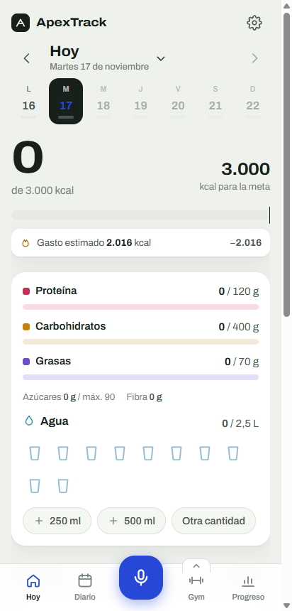
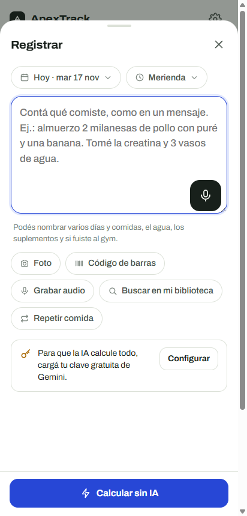
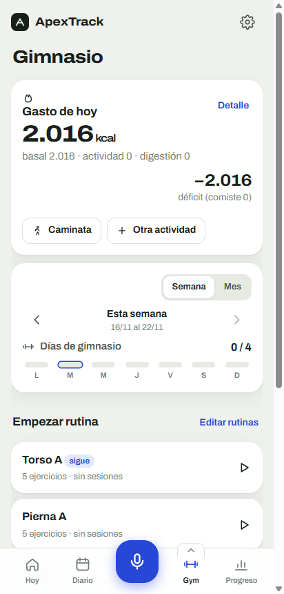
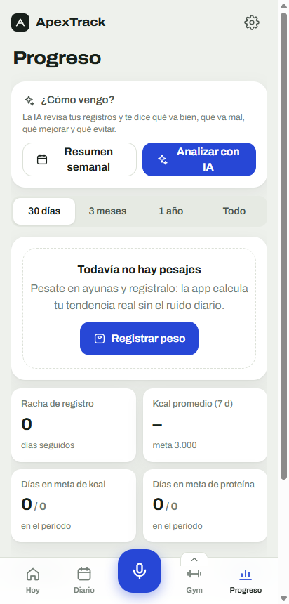

# ApexTrack: AI nutrition, gym and progress tracker

**[Try the demo →](https://ignacioandino2005.github.io/ApexTrack-2.0/)** (open it on a phone, or in a narrow window on a computer. It works without an AI key in "Calcular sin IA" mode)

ApexTrack is a mobile web app (PWA) for logging food, calories, macros, water, supplements, gym sessions, activity, weight and study time. You log by **typing, dictating or recording a voice note** in plain Spanish, the same way you would write a message. An LLM (Google Gemini) interprets the message, and the app does the math.

I built it for daily personal use, working with Claude Code as my coding partner. This repository holds the project overview only, not the source code.

| Today | Log a meal | Gym | Progress |
|---|---|---|---|
|  |  |  |  |

## What it does
- **Natural-language logging:** "lunch: 2 chicken milanesas with mashed potatoes and a banana, I took creatine and 3 glasses of water." The app turns that into separate food items, meal times, water and habits.
- **Voice, audio, photos and barcodes:** you can dictate a meal, record an audio note, snap a photo or scan a barcode. The barcode lookup uses Open Food Facts.
- **Gym and energy:** routines and sessions, plus an estimate of daily energy use (Mifflin-St Jeor equation, MET-based activities, gym sessions and digestion) to track your deficit or surplus.
- **Progress analysis:** AI summaries for the last week, month or 3 months, with charts.
- **Study and habits tabs**, light and dark themes, and Android back-button support.

## Engineering highlights
- **The app never trusts the AI's numbers:** each answer is checked with the Atwater energy formula and compared with a library of about 190 calibrated foods. Doubtful items are flagged and everything is recalculated.
- **Model routing and rate limiting:** the app spreads requests across several Gemini models, queues them, and switches to another model when one hits its limit (429) or is unavailable (503). Model choice comes from measured speed and quality, not the model's version number.
- **Works without AI:** if no model is available, a local parser still logs common foods.
- **Offline-first storage:** data is saved in three places in the browser (IndexedDB, localStorage and an OPFS file), with daily snapshots and a guard against overwriting real data with an empty state. There is an automatic backup to Google Drive through Google Apps Script.
- **Excel import and export** with ExcelJS, including migration from the earlier version, which used Google Sheets and Apps Script.
- **Tests:** unit tests for the food parser and the AI pipeline, plus 58 end-to-end checks in a mobile-sized Chromium browser (Playwright) and 12 data-recovery scenarios.

## Stack
Plain HTML, CSS and JavaScript (ES modules, no framework and no build step), a service worker, the Gemini API, Open Food Facts, Google Apps Script, ExcelJS and Playwright.

## Contact
Built by **Andino Works**. More projects: [github.com/andinoworks](https://github.com/andinoworks)
